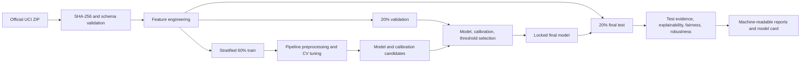

# Explainable Risk Intelligence

**Calibrated credit-default risk intelligence with leakage-safe evaluation, explainability, subgroup
auditing, and decision-threshold analysis.**

This repository is a reproducible applied-machine-learning portfolio project for financial-services
decision support. It estimates next-month default probability and makes the uncertainty, error profile,
calibration, model drivers, subgroup performance, and threshold trade-offs inspectable. It is **not** an
automated credit-decision system and makes no claim of regulatory approval or production validation.

## Executive summary

- Uses the official UCI *Default of Credit Card Clients* benchmark: 30,000 records and a binary target.
- Enforces a stratified 60/20/20 train/validation/test design; training cannot load the final-test split,
  which is opened only after model, calibration, and threshold choices are persisted.
- Compares a dummy baseline, logistic regression, random forest, and histogram gradient boosting.
- Tunes only inside training folds and selects the model on validation average precision.
- Evaluates calibration, bootstrap uncertainty, error costs, global/local explanation, subgroup metrics,
  robustness, and a drift-monitoring demonstrator.
- Excludes ID, sex, age, education, and marital status from model inputs; demographics are retained only
  for audit slices.

## Key results

<!-- GENERATED_RESULTS_START -->
Selected estimator: **tuned_hist_gradient_boosting** (sigmoid_calibrated).

| Final test metric | Value | Bootstrap 95% CI |
|---|---:|---:|
| ROC-AUC | 0.781 | 0.767 to 0.796 |
| Average precision / PR-AUC | 0.559 | 0.532 to 0.591 |
| Brier score | 0.134 | 0.128 to 0.140 |
| Log loss | 0.428 | — |
| Precision at policy threshold | 0.375 | 0.357 to 0.395 |
| Recall at policy threshold | 0.729 | 0.707 to 0.753 |
| F1 at policy threshold | 0.496 | — |

The validation-selected illustrative review threshold is **0.17** (validation calibration Brier score: 0.134). The final test was not used for model, calibration, or threshold selection.
<!-- GENERATED_RESULTS_END -->

See [the executive summary](reports/EXECUTIVE_SUMMARY.md) and
[the model card](reports/model-card/MODEL_CARD.md) for the evidence and limitations behind these numbers.

## Business problem

Probability-of-default estimates can support portfolio review, manual escalation, and model-risk
discussion, but a ranking score alone is insufficient. Reviewers also need calibrated probabilities,
the costs of errors, explanations, subgroup performance, and evidence that the test set did not leak
into development. This project treats those concerns as first-class deliverables.

The illustrative policy labels a record as “higher risk / review” above a validation-selected threshold.
That label demonstrates decision-support trade-offs; it does not approve or decline credit.

## Architecture and leakage controls



Imputation and scaling are fitted inside each scikit-learn pipeline. Unique IDs and audit demographics
never enter model training. There is no credible event timestamp in this benchmark, so the project does
not invent a pseudo-temporal split or claim temporal generalization.

## Dataset and provenance

- Source: [UCI Machine Learning Repository, dataset 350](https://archive.ics.uci.edu/dataset/350/default+of+credit+card+clients)
- DOI: [10.24432/C55S3H](https://doi.org/10.24432/C55S3H)
- Original study: I-Cheng Yeh and Che-hui Lien (2009)
- Population: 30,000 Taiwanese credit-card clients; payment history from April–September 2005
- Target: default payment in the following month
- Dataset license: CC BY 4.0; the MIT license in this repository applies only to original project code
- Official archive SHA-256: `56c885f84457f6680f8438f02bfcdac9579323d8a94465ee5f26e32baa727602`

The downloader rejects an archive whose hash or internal filename differs from the documented source.
Raw data is ignored by Git and regenerated from the official URL.

## Methodology

The model receives credit limit, six repayment-status fields, six bill amounts, six payment amounts, and
eight deterministic aggregates. The target, unique ID, and demographic audit fields are excluded.

Model development uses average precision as its primary selection measure because defaults are the
minority class and the quality of the positive-risk ranking matters more than raw accuracy. ROC-AUC,
accuracy, precision, recall, F1, Brier score, log loss, and confusion counts remain visible.

Class imbalance is handled through target-stratified splits/CV, class-weighted linear and random-forest
baselines, precision-recall metrics, and validation-only threshold analysis. The project deliberately does
not apply synthetic oversampling such as SMOTE: preserving the observed class prevalence is important for
the probability-calibration objective, and resampling is not assumed to be beneficial without validation.

Histogram gradient boosting is tuned with stratified cross-validation inside the training split. The
chosen base estimator is compared with sigmoid calibration on validation data. Calibration is retained
only if Brier score improves without a material average-precision loss. The observed gain is positive but
marginal and is not presented as a large practical improvement.

## Threshold analysis

Thresholds are evaluated on validation data with explicit illustrative costs: false positive = 1 and
false negative = 5. The minimum-cost threshold is locked before the final test is evaluated. Change the
assumptions in `src/explainable_risk_intelligence/resources/default.yaml`; do not interpret them as real
lending economics.

## Explainability

- Permutation importance measures the test-sample reduction in average precision.
- SHAP summarizes the selected base estimator globally.
- Explicitly labelled high-risk, low-risk, and near-threshold local examples list original values,
  transformed values, and risk-increasing or risk-reducing attributions.

Feature attribution is not causality. If sigmoid calibration is selected, SHAP explains the underlying
base estimator, while the presented default probability comes from the calibrated model.

## Fairness and responsible AI

Sex and age bands are used only for test-time audit slices. The project reports selection rate, recall,
false-positive rate, precision, demographic-parity difference, equal-opportunity difference, and
equalized-odds difference. These descriptive gaps cannot establish that a model is fair, unbiased, or
legally acceptable. Real evaluation depends on use context, jurisdiction, data quality, and governance.

## Error analysis, robustness, and monitoring

False positives, false negatives, and near-threshold cases are analyzed with normalized rates, sample
sizes, and descriptive subgroup segments; see [the error analysis](reports/ERROR_ANALYSIS.md). Robustness
checks inject missing values, apply internally consistent feature perturbations through the canonical
feature builder, validate both accepted and rejected inputs, and quantify uncertainty with bootstrap
intervals.

The monitoring demonstrator applies a synthetic shift to base fields, rebuilds dependent engineered
features, and calculates PSI, KS statistics, feature shifts, and prediction-distribution changes. It is a
prototype, not evidence of production operation.

## Quickstart and full reproduction

Requires Python 3.11–3.13.

```bash
make install
make quality
make test
make reproduce
make notebook-check
```

`make install` selects a fully pinned lock from the invoking interpreter: Python 3.11 and 3.12 use
`requirements-lock-py311.txt`, while Python 3.13 uses `requirements-lock-py313.txt`. The 3.11 baseline
lock has been resolved as a complete Linux wheel set for CPython 3.11 and 3.12. The 3.13 lock preserves
the exact environment used for the verified model reproduction. Both locks are fully pinned; neither CI
path performs unpinned dependency resolution. Editable installation and package build disable isolated
build environments so the pinned `setuptools`, `wheel`, and `build` versions are used as well.

Equivalent commands:

```bash
.venv/bin/python -m explainable_risk_intelligence.cli download-data
.venv/bin/python -m explainable_risk_intelligence.cli prepare-data
.venv/bin/python -m explainable_risk_intelligence.cli train
.venv/bin/python -m explainable_risk_intelligence.cli evaluate
.venv/bin/python -m explainable_risk_intelligence.cli report
```

The default YAML configuration is shipped inside the Python package, so an installed wheel does not
depend on a repository-relative `configs/` directory. Generated outputs use the detected repository root
when run from a checkout and otherwise the current working directory. Set `ERI_PROJECT_ROOT` explicitly
when an installed CLI should write to another workspace.

CI maps Python 3.11 explicitly to `requirements-lock-py311.txt` and Python 3.13 explicitly to
`requirements-lock-py313.txt`, then installs the local package without resolving new dependencies. Each
matrix entry runs Ruff, the lightweight repository audit, pytest, the curated notebook, an offline
synthetic model smoke test, package build, and installed-wheel smoke test. The audit is a useful fail-fast
gate, not a replacement for a professional secret scanner.

`make notebook-check` reads only publishable evidence under `reports/`; it works from a fresh clone without
generated data, fitted models, or `artifacts/model_metadata.json`. A full `make reproduce` refreshes both
the ignored runtime artifacts and the versioned evidence copy at
`reports/metrics/model_metadata.json` from one canonical metadata object.

## Repository structure

```text
src/.../resources/default.yaml  packaged assumptions and seeds
data/{raw,interim,processed}/    generated and Git-ignored data
artifacts/                       generated and Git-ignored runtime models/metadata
docs/                            methodology, data, and responsible-use notes
notebooks/                       curated report exploration; no hidden core logic
reports/figures/                 generated visual evidence
reports/metrics/                 publishable machine-readable evaluation evidence
reports/model-card/              generated model card
scripts/                         repository audit utility
src/explainable_risk_intelligence/
  data/ features/ models/ evaluation/ explainability/ fairness/ monitoring/ utils/
tests/{unit,integration}/         substantive unit and pipeline checks
```

## Quality and reproducibility

```bash
make quality       # Ruff lint/format plus lightweight repository audit
make test          # unit and integration tests
make smoke         # offline package/model smoke test
make notebook-check # execute every notebook code cell from the project root
.venv/bin/python -m build
```

All reported result values originate from publishable JSON/CSV evidence under `reports/`. The `report`
command refreshes the README result block and model card from that source of truth. Runtime models and
their execution metadata remain ignored under `artifacts/`; the curated notebook never reads them.

## Limitations

- Historical 2005 data from one geography cannot establish current or cross-market performance.
- A stratified random split measures in-distribution generalization, not temporal stability.
- Dataset categories and binary demographic fields are coarse, dated, and insufficient for a complete
  fairness or legal assessment.
- The target captures observed next-month default, not causal creditworthiness.
- Illustrative error costs, perturbations, and monitoring thresholds require institutional validation.

## Responsible use

This repository is a production-oriented research and portfolio implementation. Real credit use would
require current representative data, independent validation, legal and compliance review, security and
access controls, adverse-action processes, human oversight, ongoing monitoring, and documented change
management. It must not be used as an autonomous approval, decline, pricing, or limit-setting system.
